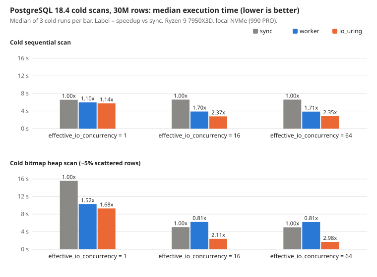

# Postgres 18 async I/O: does io_uring make reads faster?

## Question
On which workloads is PostgreSQL 18 asynchronous I/O (`io_method = worker | io_uring`) faster than the synchronous read path, and by how much?

## Scenario
Reporting queries, exports and tenant-wide aggregates in a SaaS database read more data than fits in memory. Postgres 18 ships
async I/O and makes `worker` the default. For a vertical-SaaS CTO, the question is whether upgrading or changing one setting
speeds up those cold reads, and whether the new default can make anything slower.

## Setup
- Hardware: AMD Ryzen 9 7950X3D 16C/32T, 93 GiB RAM, Samsung SSD 990 PRO 1TB (local PCIe NVMe), ext4, kernel 6.12.94, Manjaro.
- PostgreSQL 18.4, image pinned by digest (`postgres:18.4@sha256:29ee7bb3…`), Docker with `seccomp=unconfined` (needed for io_uring).
- Data: table `events`, 30,000,000 rows (~6.2 GB heap), deterministic seed. `shared_buffers=4GB` (smaller than the heap), `io_workers=3`.
- Cold run: checkpoint, stop Postgres, drop the OS page cache, start, run once. 3 cold runs per config, median reported.
- Run: 2026-07-18.
- Repo: `github.com/xp-vit/db-performance-benchmarks` (suite, commit `157ec6b`). The verified results are on local branch `hq/pg18-async-io-results`, commit `bd786f7`, public after Owner approval.

## Run
    python3 make_charts.py
This recomputes the table from the committed raw data. A full re-run is local (root, Docker); see `reproduce.md`.

## Results
Server-side execution time from `EXPLAIN ANALYZE`, median of 3 cold runs.

| workload | effective_io_concurrency | sync ms | worker ms | io_uring ms | io_uring vs sync |
|---|---:|---:|---:|---:|---:|
| sequential scan | 1 | 6,564 | 5,962 | 5,739 | 1.14x |
| sequential scan | 16 | 6,587 | 3,876 | 2,774 | 2.37x |
| sequential scan | 64 | 6,598 | 3,861 | 2,808 | 2.35x |
| bitmap heap scan | 1 | 15,565 | 10,272 | 9,287 | 1.68x |
| bitmap heap scan | 16 | 5,040 | 6,218 | 2,389 | 2.11x |
| bitmap heap scan | 64 | 5,007 | 6,197 | 1,683 | 2.98x |

Cold REINDEX (median of 3): sync 10,120 ms, worker 10,427, io_uring 8,680 (1.17x).
Warm OLTP point lookups: 212,304 / 213,171 / 212,714 tps (sync / worker / io_uring).

## What it means
- On local NVMe, io_uring made a cold 30M-row sequential scan 2.37x faster and a cold scattered bitmap scan 2.98x faster than sync.
- The default `worker` mode with 3 workers was slower than sync on cold bitmap scans (0.81x at eic 16 and 64): check before relying on the default.
- `effective_io_concurrency` matters even without async I/O: from 1 to 16 it cut the cold bitmap scan from 15.6 s to 5.0 s on sync.

## Limits
- One rig, one local NVMe drive. EBS, RDS, Aurora, other cloud disks and HDD were not measured.
- The speedups are per workload and per setting (cold, one query, one process); they are not a general "Postgres 18 is Nx faster".
- 3 cold runs per config (CV 0–6%); warm OLTP is one 20 s run per method.
- Warm bitmap scans were not flat (sync 2,685 ms, worker 1,089, io_uring 1,553): the heap does not fit in `shared_buffers`.
- VACUUM varied 24–33% (CV) between runs with different work per run, so no VACUUM number is given.
- `io_workers` fixed at 3; other worker counts, PG 17 and PG 19 were not tested. Managed Postgres may not offer io_uring.
- io_uring in Docker needed `seccomp=unconfined`; production needs a custom seccomp profile.
- The raw `mb_per_s` field overstates throughput by up to 5% (script bug); MB/s here is recomputed.

## Changelog
- 2026-07-18: benchmark run.
- 2026-11-04: numbers verified against raw data; MB/s recomputed.
- 2026-11-05: lab entry drafted.
