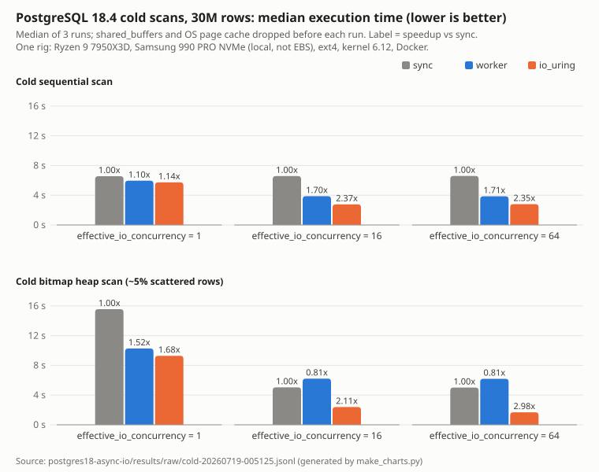

# Postgres 18 async I/O: does `io_uring` make reads faster?

Status: results from the 2026-07-18 run, verified against raw data on 2026-11-04. No re-run.
Raw data: `results/raw/cold-20260719-005125.jsonl` (72 records), `results/raw/warm-20260718-204235.jsonl`
(33 records), both committed in `157ec6b`. Auto-generated tables: `results/RESULTS.md` (`aggregate.py`).
This file and the chart: `make_charts.py` (Python 3 stdlib only).

## Question

PostgreSQL 18 adds asynchronous I/O (`io_method = sync | worker | io_uring`). On which workloads is it faster than
the pre-18 synchronous read path, by how much, and where does it not help?

## Hypothesis (stated before reading the numbers)

Async I/O helps reads that miss both `shared_buffers` and the OS page cache (cold), most on scattered reads
(bitmap heap scan), and is flat when data is served from memory (warm).

## Answer

- Cold sequential scan: **io_uring 2.37x faster than sync** (6,587 → 2,774 ms, `effective_io_concurrency=16`).
- Cold bitmap heap scan: **io_uring 2.98x faster than sync** (5,007 → 1,683 ms, `effective_io_concurrency=64`).
- `worker` (the PG18 **default**) is **0.81x, i.e. slower than sync**, on cold bitmap at eic 16 and 64.
- Warm: OLTP point lookups and warm seqscan are flat (< 15% spread). Warm bitmap is **not** flat (see caveats).



## Method

- Dataset: table `events`, 30,000,000 rows (~6.2 GB heap, ~7.9 GB with indexes), 500 tenants (skewed),
  2,000,000 customers; deterministic seed (`sql/`).
- Fixed in every arm: `shared_buffers=4GB` (smaller than the heap, so cold reads hit storage),
  `maintenance_work_mem=2GB`, `work_mem=256MB`, `effective_cache_size=24GB`, `max_wal_size=16GB`,
  `track_io_timing=on` (`docker-compose.yml`). Scans run single-process (`max_parallel_workers_per_gather=0`).
- Variables: `io_method` (`ALTER SYSTEM` + restart), `effective_io_concurrency` 1 / 16 / 64 (per session),
  `maintenance_io_concurrency` 16 (VACUUM/REINDEX). `io_workers` = 3 (default; the 3/6/12 sweep was not run).
- Cold run = `CHECKPOINT`, stop container (flushes `shared_buffers`), `sync`, `echo 3 > /proc/sys/vm/drop_caches`,
  start, run the operation once. 3 cold runs per config, median reported.
- Warm run = `io_method` restart, one priming seqscan, then 5 runs per config, no cache drop.
  OLTP: pgbench PK lookups, 8 clients, 20 s, **1 run per method**.
- Metric: server-side `Execution Time` from `EXPLAIN (ANALYZE, BUFFERS, TIMING)`; wall time for VACUUM/REINDEX;
  read volume from the plan's `Buffers: shared read` × 8 KB.
- Workloads: seqscan = `SELECT count(*), sum(amount_cents), avg(amount_cents) FROM events`;
  bitmap = same aggregate `WHERE event_type IN (2,5) AND status = 3` (~5% of rows, scattered).

## Environment

| | |
|---|---|
| CPU | AMD Ryzen 9 7950X3D, 16 cores / 32 threads |
| RAM | 93 GiB |
| Disk (PGDATA) | **Samsung SSD 990 PRO 1TB, local PCIe NVMe. Not EBS, not network storage.** |
| Filesystem / kernel / OS | ext4 / 6.12.94-1-MANJARO / Manjaro Linux |
| PostgreSQL | 18.4, image `postgres:18.4@sha256:29ee7bb30d804447dc9a91fd0d74322ae1dc3a4072cc6346f70a5ed6e783b565` |
| Container | Docker 29.x (minor not recorded), `seccomp=unconfined` (required for io_uring) |
| Run date | 2026-07-18 (UTC stamps in raw data: warm 18:42Z, cold 22:51Z) |

Source: `results/rig.json`, `METHODOLOGY.md`, `docker-compose.yml`.

## Numbers

### Cold scans (3 runs each; MB/s recomputed from raw, see caveat 4)

| workload | eic | io_method | median exec ms | min-max ms | MB/s | speedup vs sync |
|---|---|---|---|---|---|---|
| seqscan | 1 | sync | 6,564 | 6,458-6,573 | 1,084 | 1.00x |
| seqscan | 1 | worker | 5,962 | 5,873-6,090 | 1,194 | 1.10x |
| seqscan | 1 | io_uring | 5,739 | 5,632-5,821 | 1,240 | 1.14x |
| seqscan | 16 | sync | 6,587 | 6,536-6,609 | 1,080 | 1.00x |
| seqscan | 16 | worker | 3,876 | 3,832-3,893 | 1,836 | 1.70x |
| seqscan | 16 | io_uring | 2,774 | 2,738-2,833 | 2,565 | **2.37x** |
| seqscan | 64 | sync | 6,598 | 6,574-6,711 | 1,079 | 1.00x |
| seqscan | 64 | worker | 3,861 | 3,831-3,923 | 1,843 | 1.71x |
| seqscan | 64 | io_uring | 2,808 | 2,721-3,114 | 2,534 | 2.35x |
| bitmap | 1 | sync | 15,565 | 15,458-15,800 | 369 | 1.00x |
| bitmap | 1 | worker | 10,272 | 10,108-10,310 | 559 | 1.52x |
| bitmap | 1 | io_uring | 9,287 | 9,254-9,461 | 619 | 1.68x |
| bitmap | 16 | sync | 5,040 | 4,955-5,110 | 1,139 | 1.00x |
| bitmap | 16 | worker | 6,218 | 6,180-6,227 | 924 | **0.81x** |
| bitmap | 16 | io_uring | 2,389 | 2,381-2,501 | 2,407 | 2.11x |
| bitmap | 64 | sync | 5,007 | 4,959-5,073 | 1,147 | 1.00x |
| bitmap | 64 | worker | 6,197 | 6,161-6,272 | 927 | **0.81x** |
| bitmap | 64 | io_uring | 1,683 | 1,649-1,725 | 3,416 | **2.98x** |

Blocks read per run are identical across runs of a config (seqscan 868,782; bitmap 700,996-701,965), so every arm read the same data.

### Cold maintenance (3 runs each, `maintenance_io_concurrency=16`)

| op | io_method | median wall ms | runs (ms) | speedup vs sync | quotable? |
|---|---|---|---|---|---|
| VACUUM | sync | 78,859 | 56,319 / 79,496 / 78,859 | 1.00x | no |
| VACUUM | worker | 51,993 | 43,135 / 51,993 / 73,114 | 1.52x | no (CV 24%) |
| VACUUM | io_uring | 47,710 | 73,900 / 47,710 / 36,484 | 1.65x | no (CV 33%) |
| REINDEX | sync | 10,120 | 10,155 / 9,696 / 10,120 | 1.00x | yes |
| REINDEX | worker | 10,427 | 11,026 / 10,234 / 10,427 | 0.97x | yes |
| REINDEX | io_uring | 8,680 | 8,680 / 8,154 / 8,753 | 1.17x | yes |

### Warm

| workload | sync | worker | io_uring | runs | spread |
|---|---|---|---|---|---|
| OLTP point lookup (tps) | 212,304 | 213,171 | 212,714 | **1** per method | 0.4% (flat) |
| seqscan (median ms) | 2,985 | 2,714 | 2,930 | 5 | 9% (flat, < 15%) |
| bitmap (median ms) | 2,685 | 1,089 | 1,553 | 5 | 103% of median; **not flat** |

## Caveats

1. **One rig, one storage device.** Local NVMe (990 PRO). On EBS / network storage (higher latency) the cold wins
   are expected to differ (likely larger), but that is **not measured here**.
2. **io_uring ran with `seccomp=unconfined`.** Docker's default profile blocks the io_uring syscalls; production
   needs a custom seccomp profile. Managed Postgres (RDS etc.) may not offer `io_uring` at all; not checked.
3. **"Warm" means OS page cache warm, not all-in-`shared_buffers`.** The 6.2 GB heap exceeds 4 GB `shared_buffers`,
   so warm reads still go through syscalls. That likely explains why warm bitmap is not flat (worker 2.5x faster
   than sync). This explanation is a hypothesis, not tested. The first warm sync bitmap run (3,348 ms) is also
   colder than the next four (2,651-2,690 ms).
4. **MB/s bug in `bench/run-cold.sh`:** `bc scale=1` truncates seconds to 0.1 s, so the `mb_per_s` field in raw data
   and in `results/RESULTS.md` overstates throughput by up to 5% (bitmap io_uring eic 64: 3,594 recorded vs 3,416
   recomputed). Speedups use `exec_ms` and are **not** affected. The table above uses `mb_read / exec_ms`.
5. **OLTP flat is n=1** (one 20 s pgbench run per method). `aggregate.py` does not flag n<3 for warm rows.
6. **VACUUM is not reproducible as run:** CV 24-33% and blocks read differ per run (70k-165k), because each run
   updates a different 5% slice (`id % 20 = run-1`). Directional only.
7. `io_workers` was fixed at 3; the worker regression on cold bitmap may change with more workers (not measured).
8. 3 cold runs per config is the minimum; cold-scan CV is 0-6%, so the medians are stable, but this is not a
   statistically powered study.
9. `effective_io_concurrency` is a bigger lever than `io_method` for bitmap scans on sync: 15,565 → 5,040 ms
   from eic 1 → 16 (3.1x) with no async I/O at all.

## What may be claimed

- "On a local NVMe, PG 18.4 `io_uring` ran a cold 30M-row sequential scan 2.37x faster than `sync`, and a cold
  scattered bitmap heap scan 2.98x faster (with `effective_io_concurrency=64`)."
- "The default `io_method=worker` was 0.81x of sync (slower) on cold bitmap scans at eic 16/64 with 3 io_workers."
- "Raising `effective_io_concurrency` from 1 to 16 cut the cold bitmap scan from 15.6 s to 5.0 s even on sync."
- "Cached OLTP point lookups did not change (212-213k tps, one run each)."

## What must not be claimed

- "Postgres 18 is 3x faster." The 2.98x is one workload, cold, io_uring, eic 64, on NVMe.
- Any number for EBS, RDS, Aurora, cloud disks or HDD. Not measured.
- "Async I/O is flat when warm" without qualification: warm bitmap was not flat.
- Any VACUUM speedup as a number (CV 24-33%, non-identical work per run).
- The MB/s column of `results/RESULTS.md` (truncation bug); use the recomputed MB/s above.
- "worker is always slower" or "io_uring is always faster": only the swept configs were measured.
- Comparisons with PG 17 or PG 19: not measured.

## How to reproduce

Needs Linux, Docker with Compose, root (for `drop_caches`), ~12 GB free disk, Python 3.

```bash
git clone https://github.com/xp-vit/db-performance-benchmarks.git
cd db-performance-benchmarks/postgres18-async-io
./load.sh                       # PG 18.4 (pinned digest) + resumable 30M-row load
./bench/run-warm.sh             # warm sweep, no root
sudo -v && ./bench/run-cold.sh  # cold sweep, drops caches (root)
python3 aggregate.py            # raw/*.jsonl -> results/RESULTS.md
python3 make_charts.py          # raw/*.jsonl -> results/charts/cold-scans.svg + table above
```

To regenerate this file's tables and chart from the committed raw data only: `python3 make_charts.py`.
Record your own `results/rig.json` (CPU, disk model and type, fs, kernel) before publishing any number.
